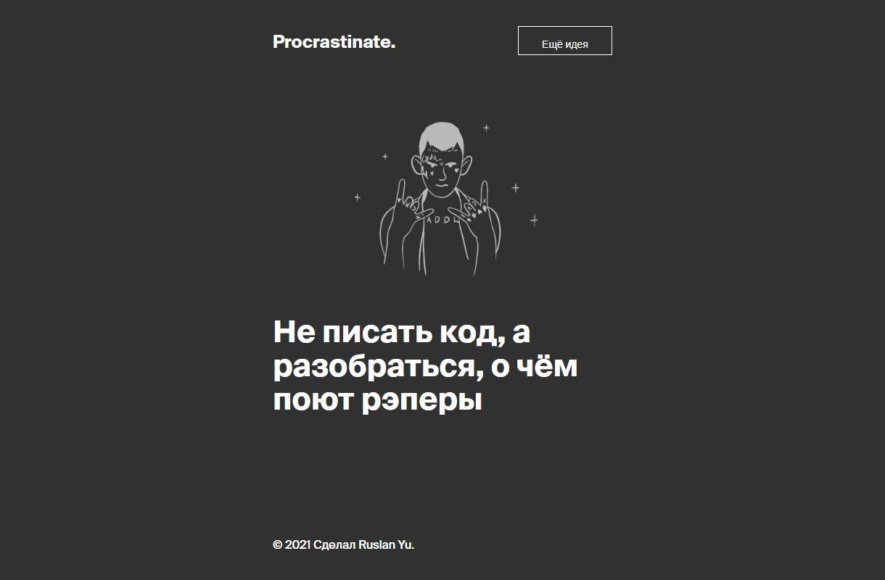

# 🎲 Procrastinate.

**Генератор идей для тех, кто ищет, чем заняться вместо работы.**

 

[Открыть страницу](https://goldlexx.github.io/procrastination/)

Кнопка **«Ещё идея»** меняет и подпись, и иллюстрацию. Пары выбраны из подготовленного списка, поэтому варианты могут повторяться. Длинные фразы выводятся уменьшенным шрифтом, а кнопку можно активировать с клавиатуры.

## Локальный запуск

Откройте `index.html` из корня репозитория в браузере.

## Проверка

`node --test` проверяет начальное состояние, выбор идеи, замену изображения и размер длинной подписи.
